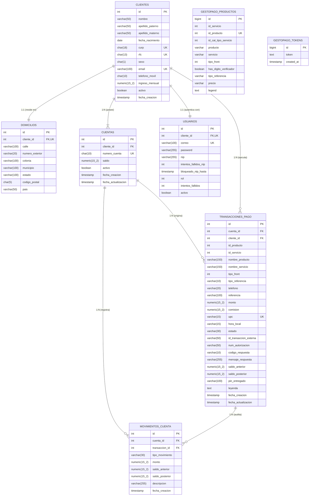
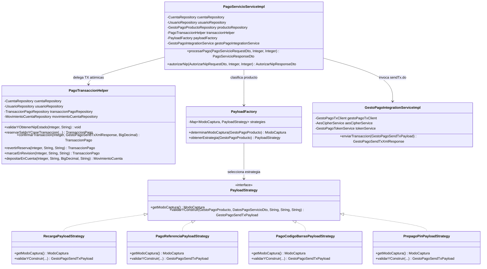
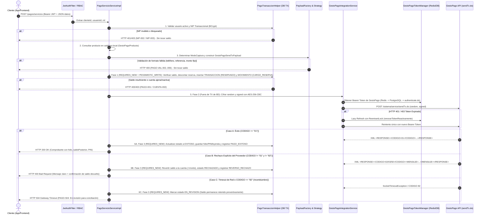

# Documentación Técnica: Proyecto Integrador — Onboarding Bancario e Integración Transaccional de Pagos de Servicios y Recargas (GestoPago)

## 1. Introducción y Resumen Ejecutivo
El proyecto implementa un sistema bancario integral que abarca desde el **Onboarding de Clientes Personas Físicas** hasta un **Motor Transaccional de Pagos de Servicios, Recargas de Tiempo Aire y Pines Prepagados** integrado en tiempo real con el proveedor externo **GestoPago (`sendTx.do`)**, bajo una arquitectura de API REST empresarial con **Java 21**, **Spring Boot 3.3.6**, **Spring Data JPA**, **Spring Cloud OpenFeign**, **Redis**, **Flyway**, **MapStruct**, **BCrypt**, **AES-256-CBC** y **PostgreSQL**.

La solución contempla el **flujo extremo a extremo de la operación**:
1. **Autenticación y Autorización del Cliente**: Sesión con **JWT**, control de acceso basado en roles (**RBAC**), prevención de vulnerabilidades **IDOR** y validación de pertenencia y estatus activo de cliente, usuario y cuenta bancaria.
2. **Autorización de Segunda Capa con NIP Transaccional (BCrypt)**: Almacenamiento irreversible con **BCrypt**, contador de intentos fallidos y bloqueo temporal automático de 15 minutos al tercer fallo consecutivo.
3. **Clasificación Inteligente del Catálogo Local (`GestoPagoProducto`)**: Identificación automática de la modalidad de captura (`RECARGA`, `PAGO_REFERENCIA`, `PAGO_CODIGO_BARRAS`, `PREPAGO_PIN`) mediante los patrones **Strategy y Factory** a partir de `tipoFront`, `tipoReferencia` e `idCatTipoServicio`, sin depender de que el frontend conozca las reglas internas del proveedor.
4. **Arquitectura Transaccional de Tres Fases (`Reservar → Llamada Externa → Confirmar / Revertir / En Revisión`)**: Protección contra condiciones de carrera con bloqueo pesimista (`PESSIMISTIC_WRITE`), generación de identificador único de operación (`upc`) para evitar cargos duplicados, liberación de conexiones de base de datos durante la llamada HTTP externa y manejo diferenciado entre **rechazos explícitos** (reverso inmediato) e **incertidumbre por timeout** (`EN_REVISION` sin reintento ciego ni devolución automática).
5. **Seguridad Criptográfica y Resiliencia con GestoPago**: Cifrado **AES-256-CBC (`PKCS5Padding` + Base64)** para los parámetros `random` y `signed`, gestión del token JWT de GestoPago en caché híbrida (**Redis + PostgreSQL**) con renovación reactiva (*Lazy Refresh* ante `HTTP 401/403` protegida con `ReentrantLock`) y parseo tolerante a fallos de respuestas XML (`<RESPONSE>` y `<AUTORIZACION>`).

---

## 2. Entregables del Proyecto
1. **Diagrama Entidad-Relación (Base de Datos)**: Esquema relacional completo incluyendo Onboarding (`CLIENTES`, `DOMICILIOS`, `CUENTAS`, `USUARIOS`) y el Motor Transaccional de Pagos (`TRANSACCIONES_PAGO`, `MOVIMIENTOS_CUENTA`, `GESTOPAGO_PRODUCTOS`, `GESTOPAGO_TOKENS`).
2. **Diagrama de Clases y Arquitectura de Pagos (Java)**: Modelado orientado a objetos, entidades JPA, patrón **Strategy + Factory** de payloads y servicios transaccionales.
3. **Diagrama de Secuencia del Flujo Completo de Pago**: Flujo de extremo a extremo desde la petición del cliente hasta la conciliación con GestoPago.
4. **Análisis de Riesgos, Escenarios de Fallo y Justificación de Decisiones de Diseño**: Evaluación exhaustiva de concurrencia, timeouts, caídas de red, idempotencia, expiración de tokens y seguridad criptográfica.
5. **Scripts de Base de Datos Versionados con Flyway**:
   - `V1__init.sql` y `V2__add_gestopago_tokens.sql` (Catálogo y tokens de GestoPago).
   - `V3__create_onboarding_clientes_cuentas_usuarios.sql` y `V4__insert_admin_default.sql` (Onboarding y semilla Admin).
   - `V5__add_modo_captura_gestopago_productos.sql` (Columna `modo_captura` e índices de búsqueda en `gestopago_productos`).
   - `V6__add_nip_fields_usuarios.sql` (Campos de NIP transaccional cifrado con BCrypt y bloqueo temporal en `usuarios`).
   - `V7__create_transacciones_pago_y_movimientos.sql` (Tablas `transacciones_pago` y `movimientos_cuenta` con índices y `UNIQUE (upc)`).
6. **API REST Funcional**: Catálogo completo de endpoints de Onboarding, Catálogo filtrable, NIP Transaccional, Depósitos y Pagos de Servicios.
7. **Suite de Pruebas Automatizadas**: Más de 170 pruebas unitarias y de integración con 100% de éxito verificadas con JUnit 5 y Mockito.

---

## 3. Decisiones de Diseño y Buenas Prácticas

### 3.1. Tipos de Datos y Optimización en Base de Datos (PostgreSQL & JPA)
- **Longitud fija (`CHAR(n)`)**: Para campos estandarizados de longitud inmutable:
  - `curp`: `CHAR(18)` | `rfc`: `CHAR(13)` | `telefono_movil`: `CHAR(10)` | `numero_cuenta`: `CHAR(10)` | `codigo_postal`: `CHAR(5)` | `sexo`: `CHAR(1)` (`'H'`, `'M'`, `'X'`).
- **Montos Monetarios (`NUMERIC(15,2)` y `BigDecimal`)**: Garantizan precisión decimal exacta en saldos, montos de pago, comisiones y bitácora contable (`saldo_anterior`, `saldo_posterior`), evitando errores de redondeo de punto flotante.
- **Unicidad Transaccional (`upc VARCHAR(15) UNIQUE`)**: Cada intento de pago genera un identificador único alfanumérico de 12 caracteres (`GP` + 10 caracteres criptográficos) validado con restricción `UNIQUE` a nivel de base de datos.

### 3.2. Sanitización Declarativa con MapStruct
El componente `StringSanitizer.java` (`src/main/java/com/proyecto/servicios/mapper/StringSanitizer.java`) normaliza entradas de forma declarativa:
- `@Named("trim")`: Limpia espacios en blanco iniciales y finales.
- `@Named("trimUpper")`: Limpia espacios y convierte automáticamente a mayúsculas (CURP, RFC, Sexo).
- `@Named("trimLower")`: Limpia espacios y convierte a minúsculas (Email).

---

## 4. Diagramas del Sistema

### 4.1. Diagrama Entidad-Relación Completo (Base de Datos)


### 4.2. Diagrama de Clases del Motor de Pagos y Patrón Strategy + Factory


---

## 5. Flujo Completo de la Operación de Pago (`POST /pagos/servicios`)

### 5.1. Diagrama de Secuencia Extremo a Extremo


### 5.2. Reglas de Clasificación y Construcción de Payload (`PayloadFactory`)
El backend determina automáticamente cómo construir el JSON a cifrar en el parámetro `signed` inspeccionando el producto del catálogo local:

| Modalidad (`ModoCaptura`) | Condición en Catálogo (`GestoPagoProducto`) | Campos Validados al Cliente | Reglas del Payload Enviado a GestoPago (`sendTx.do`) |
| :--- | :--- | :--- | :--- |
| **`PREPAGO_PIN`** | `idCatTipoServicio` en `{10, 11}` o nombre contiene `pin`/`certificado`/`regalo` | `monto` debe coincidir con `precio` fijo del catálogo; `telefono` opcional (rellena `"1111111111"` si se omite). | Envía `idProducto`, `idServicio`, `telefono`, `horaLocal`, `upc`, `unidad`. **No envía** `referencia` ni `montoPago` (el monto está implícito en `idProducto`). |
| **`RECARGA`** | `tipoFront == 1` | `telefono` obligatorio de exactamente 10 dígitos numéricos; `monto` debe coincidir con `precio` del catálogo. | Envía `idProducto`, `idServicio`, `telefono`, `horaLocal`, `upc`, `unidad`. **No envía** `referencia` ni `montoPago`. |
| **`PAGO_REFERENCIA`** | `tipoFront == 2` y `tipoReferencia` contiene `'a'` o `'b'` | `referencia` obligatoria (4 a 60 caracteres); `monto > 0` libre (recibo del cliente; en catálogo `precio` representa la comisión). | Fija `telefono = "1111111111"`, incluye `referencia` y serializa `montoPago` como número JSON (`@JsonRawValue`). |
| **`PAGO_CODIGO_BARRAS`** | `tipoFront == 2` y `tipoReferencia` es exclusivamente `'c'` | `referencia` obligatoria (4 a 100 caracteres sin espacios); `monto > 0` libre. | Fija `telefono = "1111111111"`, incluye `referencia` (código de barras) y serializa `montoPago` como número JSON. |

---

## 6. Análisis de Riesgos, Escenarios de Fallo y Justificación de Decisiones de Diseño

Para cumplir con los estándares de un sistema financiero en producción, no basta con consumir el endpoint externo; se diseñó una arquitectura defensiva frente a los siguientes riesgos críticos:

### 6.1. Riesgo 1: Condiciones de Carrera (Race Conditions) y Doble Gasto Concurrente
- **Escenario de Fallo**: Un cliente con `$100.00` de saldo dispara simultáneamente 2 o más peticiones de pago de `$100.00` desde distintos dispositivos o hilos concurrentes. Si ambas leen `saldo = 100.00` antes de que la otra actualice, ambas pasarían la validación y dejarían un sobregiro ilegal (`-$100.00`).
- **Decisión de Diseño y Mitigación**:
  - Se implementó `CuentaRepository.findByNumeroCuentaForUpdate(numeroCuenta)` con bloqueo pesimista a nivel de fila en PostgreSQL (`@Lock(LockModeType.PESSIMISTIC_WRITE)` -> `SELECT ... FOR UPDATE`).
  - Cuando entra la primera transacción, adquiere el candado sobre la fila de la cuenta; cualquier petición concurrente sobre la misma cuenta espera en cola hasta que la primera confirme la reserva del saldo, viendo inmediatamente el saldo actualizado (`$0.00`) y rechazándose con `PAGO-001` (`SaldoInsuficienteException`).

### 6.2. Riesgo 2: Agotamiento del Pool de Conexiones de Base de Datos (Connection Starvation)
- **Escenario de Fallo**: La API externa de GestoPago (`sendTx.do`) depende de carriers telefónicos y proveedores de servicios (CFE, Izzi, Agua) que pueden tardar hasta 20 segundos en responder. Si se mantuviera abierta una transacción `@Transactional` (y el `SELECT ... FOR UPDATE`) durante la llamada HTTP externa, 20 peticiones lentas saturarían por completo el pool de HikariCP (`maximum-pool-size=20`), tirando todo el banco.
- **Decisión de Diseño y Mitigación**:
  - Se desacopló la operación en **3 transacciones cortas independientes** (`Propagation.REQUIRES_NEW`) gestionadas por `PagoTransaccionHelper`:
    1. **Fase 1 (`reservarSaldoYCrearTransaccion`)**: Abre TX, bloquea cuenta, descuenta el saldo preventivamente, inserta la transacción en estado `RESERVADO` y el movimiento `CARGO_RESERVA`, **hace commit y libera la conexión a PostgreSQL en milisegundos**.
    2. **Fase 2 (`enviarTransaccion`)**: Se ejecuta **sin transacción de base de datos activa**. Realiza el cifrado AES-256-CBC y la llamada HTTP por OpenFeign a GestoPago.
    3. **Fase 3 (`confirmarTransaccion` / `revertirReserva` / `marcarEnRevision`)**: Una vez obtenida la respuesta de GestoPago, abre una segunda TX milimétrica para asentar el estado definitivo (`EXITOSO`, `RECHAZADO` o `EN_REVISION`).

### 6.3. Riesgo 3: Incertidumbre por Timeout de Lectura vs. Rechazo Explícito del Proveedor
- **Escenario de Fallo**: El servidor envía el cargo a GestoPago, pero a los 20 segundos ocurre un `SocketTimeoutException`, un corte de red o GestoPago devuelve `<CODIGO>82</CODIGO>` (*La transacción continúa en proceso*).
  - **¿Por qué NO se debe hacer un reintento automático ciego con un nuevo `upc`?** Porque si el primer pago sí se aplicó en el carrier, un segundo envío cobraría y abonaría el servicio dos veces.
  - **¿Por qué NO se debe devolver el saldo automáticamente al cliente ante un timeout?** Porque si GestoPago sí procesó la recarga o el pago de recibo, devolver el saldo automáticamente permitiría al cliente retirar o volver a gastar ese dinero, generando pérdida financiera para la institución.
- **Decisión de Diseño y Mitigación**:
  - **Diferenciación estricta de fallos**:
    - **Rechazo Explícito (`CODIGO != "01"` y `!= "82"`, ej. `02`, `03`, `05`, `50`)**: Sabemos con certeza que GestoPago **no** aplicó el cargo. Se ejecuta `revertirReserva()` de forma inmediata y automática, devolviendo el dinero a la cuenta del cliente y registrando un movimiento contable `REVERSO_RECHAZO`.
    - **Incertidumbre / Timeout (`SocketTimeoutException`, error 5xx de red o `CODIGO == "82"`)**: Se lanza `GestoPagoTimeoutException` y se ejecuta `marcarEnRevision()`. La transacción queda en estado `EN_REVISION` conservando el mismo `upc` y el saldo permanece retenido preventivamente.
  - **Job Programado de Conciliación (`ConciliacionPagosScheduler`)**: Una tarea programada audita periódicamente todas las transacciones en estado `EN_REVISION` que superen el umbral configurado (`5 minutos`), dejándolas identificadas con su `upc` original para conciliación sin riesgo de doble cobro.

### 6.4. Riesgo 4: Pagos Duplicados y Garantía de Idempotencia (`upc`)
- **Escenario de Fallo**: Colisión de identificadores de operación enviados al proveedor o intentos repetidos con el mismo folio interno.
- **Decisión de Diseño y Mitigación**:
  - Cada operación genera un identificador único `upc` de 12 caracteres (`GP` + 10 caracteres generados con `SecureRandom`) verificado contra `TransaccionPagoRepository.existsByUpc(upc)` y respaldado por un constraint `UNIQUE (upc)` en la tabla `transacciones_pago`.

### 6.5. Riesgo 5: Expiración del Token JWT de GestoPago y Estampida de Login (Thundering Herd)
- **Escenario de Fallo**: El token Bearer que entrega GestoPago en `authenticate.do` tiene vigencia aproximada de 24 horas, pero puede ser invalidado anticipadamente por el proveedor devolviendo `HTTP 401` o `HTTP 403`. Si 50 hilos reciben `401` al mismo tiempo y todos llaman a `authenticate.do`, bloquearían la cuenta del distribuidor en GestoPago.
- **Decisión de Diseño y Mitigación**:
  - **Caché Híbrida (Redis + PostgreSQL)**: `GestoPagoTokenManager` lee primero de Redis (`gestopago:jwt:token` con TTL de 23h); si Redis no está disponible o expira, recupera de PostgreSQL (`gestopago_tokens`), y solo si no existe se autentica contra `authenticate.do`.
  - **Renovación Reactiva (*Lazy Refresh*) con Doble Verificación (`ReentrantLock`)**: Cuando `GestoPagoIntegrationServiceImpl` detecta `HTTP 401/403` al llamar a `sendTx.do`, invoca `tokenManager.renovarTokenReactivamente(tokenFallido)`. El método adquiere un `ReentrantLock`; el primer hilo renueva el token en GestoPago y actualiza Redis/PostgreSQL, mientras que los hilos subsecuentes ven que el token actual ya cambió respecto al `tokenFallido` y reutilizan el nuevo token sin volver a golpear `authenticate.do`.

### 6.6. Riesgo 6: Exposición de Credenciales, Llaves AES y NIP en Bitácoras (Logs)
- **Escenario de Fallo**: Filtración de `secretKey`, `iv`, contraseñas, tokens completos o el NIP transaccional en archivos de log o respuestas de error.
- **Decisión de Diseño y Mitigación**:
  - El NIP del cliente se hashea con **BCrypt (`PasswordEncoder`)** antes de persistirse en `usuarios.nip`.
  - Al tercer intento fallido de NIP, la columna `bloqueado_nip_hasta` bloquea temporalmente las autorizaciones por `15 minutos` (`NIP-003`), deteniendo ataques de fuerza bruta sobre los 10,000 posibles PINs de 4 dígitos.
  - En los logs de `GestoPagoIntegrationServiceImpl` jamás se imprime el texto plano de `random`, `signed`, ni las llaves AES; únicamente se registra el `upc`, `idProducto`, `idServicio` y el código de resultado.

---

## 7. Seguridad, RBAC, JWT y Reglas de Negocio

### 7.1. Control de Acceso Basado en Roles (RBAC) y Prevención IDOR
- **Administrador (`rol = 1`)**: Privilegios para listar clientes, ver cuentas activas, paginación, bajas/reactivaciones, desbloqueo de credenciales y abono de saldo (`POST /cuentas/depositar`).
- **Cliente (`rol = 2`)**: Acceso exclusivo a su propio perfil (`/clientes/me`), sus cuentas (`/cuentas/me`), configuración de su propio NIP y ejecución de pagos únicamente desde cuentas de las que sea titular (`cuenta.getCliente().getId().equals(clienteId)`).
- **Prevención IDOR en Pagos y Cuentas**: Si un cliente autenticado envía en el JSON el `numeroCuenta` de otro cliente, `PagoServicioServiceImpl` aborta inmediatamente con `HTTP 403 Forbidden` (`AUTH-004`).

---

## 8. Catálogo Completo de Endpoints de la API REST

### 8.1. Autenticación (`/auth`)
| Método | Endpoint | Acceso Requerido | Descripción |
| :--- | :--- | :--- | :--- |
| `POST` | `/auth/login` | Público | Autentica con correo y contraseña. Devuelve token JWT, rol y datos de sesión. |

#### Credenciales Predeterminadas para Pruebas:
| Rol | Correo / Usuario | Contraseña | NIP Transaccional | Notas |
| :--- | :--- | :--- | :---: | :--- |
| **Administrador** | `admin@banco.com` | `Admin123!` | `1234` | Generado por migraciones Flyway `V4` y `V7`. |
| **Cliente** | *(Correo registrado)* | *(Contraseña del registro)* | `1234` *(o el configurado en `/nip`)* | Cuentas activas reciben `$5,000.00` de saldo semilla en `V7`. |

---

### 8.2. Catálogo Local de Servicios y Productos GestoPago (`/catalogo`)
Todos los endpoints del catálogo operan bajo el método **`POST`** recibiendo los filtros en un cuerpo JSON `{"datos": { ... }}` y consultan directamente la base de datos local sincronizada, enriqueciendo cada producto con su `modoCaptura` (`RECARGA`, `PAGO_REFERENCIA`, `PAGO_CODIGO_BARRAS`, `PREPAGO_PIN`):

| Método | Endpoint | Acceso Requerido | Cuerpo JSON (`datos`) | Descripción |
| :--- | :--- | :--- | :--- | :--- |
| `POST` | `/catalogo/categorias` | Autenticado | `{ "nombre": " Agua " }` *(opcional)* | Lista las categorías disponibles en el catálogo local con el conteo de productos e IDs de servicio asociados. |
| `POST` | `/catalogo/servicios` | Autenticado | `{ "idCatTipoServicio": 5, "nombre": "izzi" }` *(opcionales)* | Filtra y agrupa los servicios disponibles por categoría o coincidencia parcial de nombre. |
| `POST` | `/catalogo/productos` | Autenticado | `{ "idServicio": 133, "idCatTipoServicio": 1, "tipoFront": 1, "nombre": "telcel" }` *(opcionales)* | Devuelve los productos filtrados incluyendo `idProducto`, `idServicio`, `tipoFront`, `tipoReferencia`, `precio`, `legend` y `modoCaptura`. |
| `POST` | `/api/gestopago/sincronizar-catalogo` | Autenticado | *(Sin cuerpo)* | Fuerza la sincronización manual del catálogo desde GestoPago hacia PostgreSQL. |

---

### 8.3. Pagos de Servicios, Recargas y NIP Transaccional (`/pagos` y `/usuarios/me/nip`)
| Método | Endpoint | Acceso Requerido | Descripción |
| :--- | :--- | :--- | :--- |
| `PUT` | `/usuarios/me/nip` | Cliente / Admin | Configura o actualiza el NIP transaccional de 4 dígitos (requiere `passwordActual` del usuario y `nuevoNip`). Se almacena cifrado con BCrypt. |
| `POST` | `/pagos/autorizar-nip` | Cliente / Admin | Pre-autoriza el NIP de 4 dígitos (`{"datos": {"nip": "1234"}}`) verificando intentos restantes y bloqueo temporal antes de enviar el pago. |
| `POST` | `/pagos/servicios` | Cliente / Admin | **Ejecuta el flujo completo de pago o recarga**: valida NIP, cuenta, saldo, clasifica producto, reserva saldo (`PESSIMISTIC_WRITE`), cifra y envía `sendTx.do` a GestoPago y confirma, revierte o marca en revisión la transacción. |
| `GET` | `/pagos/historial` | Cliente / Admin | Devuelve el historial de transacciones de pago del cliente autenticado ordenado del más reciente al más antiguo. |
| `GET` | `/pagos/cuenta/{numeroCuenta}` | Dueño de Cuenta / Admin | Lista las transacciones de pago asociadas a un número de cuenta específico (protegido contra IDOR). |

#### payloads Oficiales de Prueba en Sandbox de GestoPago (`POST /pagos/servicios`):
```json
// 1. Recarga Tiempo Aire Exitosa (CODIGO 01) - Telcel $10 (tipoFront = 1, modoCaptura = RECARGA)
{
  "datos": {
    "numeroCuenta": "6249003546",
    "idProducto": 582,
    "telefono": "5555555551",
    "referencia": "",
    "monto": 10,
    "pin": "6964"
  }
}

// 2. Pago de Servicio con Referencia Exitoso (CODIGO 01) - Izzi Telecom (tipoFront = 2, modoCaptura = PAGO_REFERENCIA)
{
  "datos": {
    "numeroCuenta": "6249003546",
    "idProducto": 205,
    "telefono": "",
    "referencia": "25720381",
    "monto": 601.99,
    "pin": "6964"
  }
}

// 3. Compra de Pin Prepagado Exitosa (CODIGO 01 + entrega de PIN) - Netflix $300 (modoCaptura = PREPAGO_PIN)
{
  "datos": {
    "numeroCuenta": "6249003546",
    "idProducto": 7030,
    "telefono": "5555555551",
    "referencia": "",
    "monto": 300,
    "pin": "6964"
  }
}

// 4. Simulación de Timeout del Proveedor (CODIGO 82 -> Estado EN_REVISION, HTTP 504)
{
  "datos": {
    "numeroCuenta": "6249003546",
    "idProducto": 582,
    "telefono": "9999999991",
    "referencia": "",
    "monto": 10,
    "pin": "6964"
  }
}
```

---

### 8.4. Cuentas y Depósitos (`/cuentas`)
| Método | Endpoint | Acceso Requerido | Descripción |
| :--- | :--- | :--- | :--- |
| `GET` | `/cuentas/me` | Cliente / Administrador | Obtiene el listado de cuentas activas pertenecientes al cliente autenticado. |
| `GET` | `/cuentas/{numeroCuenta}` | **Administrador o Dueño de Cuenta** | Consulta detalle de la cuenta (Valida pertenencia para el cliente, IDOR protegido). |
| `GET` | `/cuentas/{numeroCuenta}/saldo` | **Administrador o Dueño de Cuenta** | Consulta el saldo actual de la cuenta (IDOR protegido). |
| `GET` | `/cuentas/activas` | **Solo Administrador** | Lista global de todas las cuentas bancarias activas en el sistema. |
| `POST` | `/cuentas/depositar` | **Administrador o Dueño de Cuenta** | Abona saldo a una cuenta activa con bloqueo pesimista (`PESSIMISTIC_WRITE`) y registra el movimiento `ABONO_DEPOSITO` en `movimientos_cuenta`. |

---

### 8.5. Clientes (`/clientes`) y Usuarios (`/usuarios`)
| Método | Endpoint | Acceso Requerido | Descripción |
| :--- | :--- | :--- | :--- |
| `POST` | `/clientes` | Público | **Onboarding completo**: Registra cliente, domicilio, genera cuenta bancaria (10 dígitos) con saldo inicial `$0.00` y usuario. |
| `GET` | `/clientes/me` | Cliente / Administrador | Obtiene el perfil propio del cliente asociado al token JWT autenticado. |
| `GET` | `/clientes` | **Solo Administrador** | Lista todos los clientes o filtra por `filtro`, `curp`, `rfc`, `email`, `cuenta`. |
| `PUT` | `/clientes/{id}` | **Administrador o Propio Cliente** | Actualiza datos personales y de domicilio (protegido contra IDOR). |
| `DELETE` | `/clientes/{id}` | **Solo Administrador** | **Baja lógica en cascada** (desactiva cliente, cuentas y usuario). |
| `PATCH` | `/clientes/{id}/reactivar` | **Solo Administrador** | **Reactivación en cascada** (reactiva cliente, cuentas y usuario, reseteando fallos a 0). |
| `PUT` | `/usuarios/{id}/password` | **Exclusivo Propio Usuario** | Cambia la contraseña (requiere `passwordActual` y `passwordNuevo`). |
| `PATCH` | `/usuarios/{id}/desbloquear` | **Solo Administrador** | Desbloquea un usuario tras 3 intentos fallidos (`activo = true`, `intentos = 0`). |

---

## 9. Tabla Completa de Códigos de Error de la API

El controlador global `GlobalExceptionHandler.java` (`src/main/java/com/proyecto/servicios/exception/GlobalExceptionHandler.java`) estandariza todas las respuestas de error:

| Código | HTTP Status | Excepción | Motivo y Tratamiento |
| :--- | :--- | :--- | :--- |
| `VALIDACION-001` | `400 BAD REQUEST` | `MethodArgumentNotValidException` | Error de validación en campos del DTO (formato, tamaño, regex). |
| `PAGO-VAL-002` | `400 BAD REQUEST` | `ValidacionException` | Teléfono inválido para recarga (`tipoFront=1`): debe tener exactamente 10 dígitos numéricos. |
| `PAGO-VAL-003` | `400 BAD REQUEST` | `ValidacionException` | Monto distinto al precio fijo del catálogo en recargas (`RECARGA`) o pines (`PREPAGO_PIN`). |
| `PAGO-VAL-004` | `400 BAD REQUEST` | `ValidacionException` | Referencia obligatoria faltante o fuera de rango (4-60 caracteres) para `PAGO_REFERENCIA`. |
| `PAGO-VAL-005` | `400 BAD REQUEST` | `ValidacionException` | Código de barras obligatorio faltante o con espacios para `PAGO_CODIGO_BARRAS`. |
| `PAGO-VAL-006` | `400 BAD REQUEST` | `ValidacionException` | El monto para pago de servicios debe ser mayor a cero. |
| `NIP-001` | `400 BAD REQUEST` | `NipNoConfiguradoException` | El usuario aún no ha configurado su NIP transaccional de 4 dígitos (`PUT /usuarios/me/nip`). |
| `NIP-002` | `401 UNAUTHORIZED` | `NipInvalidoException` | NIP transaccional incorrecto (incrementa contador de fallos; al 3er fallo bloquea por 15 min). |
| `NIP-003` | `403 FORBIDDEN` | `NipBloqueadoException` | NIP bloqueado temporalmente por exceder el número máximo de intentos fallidos. |
| `PAGO-001` | `400 BAD REQUEST` | `SaldoInsuficienteException` | El saldo disponible en la cuenta es menor al monto de la operación. |
| `PAGO-002` | `404 NOT FOUND` | `ProductoNoEncontradoException` | El `idProducto` solicitado no existe en el catálogo local sincronizado. |
| `50` | `400 BAD REQUEST` | `GestoPagoProveedorRechazoException` | **Rechazo explícito de GestoPago** (ej. referencia inválida, monto inválido, carrier sin respuesta). **El saldo reservado ya fue devuelto íntegramente a la cuenta del cliente**. |
| `52` | `502 BAD GATEWAY` | `GestoPagoXmlParseException` | Respuesta XML corrupta o ilegible del proveedor externo. |
| `PAGO-504` | `504 GATEWAY TIMEOUT` | `GestoPagoTimeoutException` | **Timeout de red o `CODIGO 82` en GestoPago**. La transacción queda en estado `EN_REVISION` sin reintento ciego ni devolución automática hasta su conciliación. |
| `CUENTA-001` | `404 NOT FOUND` | `CuentaNoEncontradaException` | No se encontró la cuenta bancaria con el número especificado. |
| `CUENTA-002` | `403 FORBIDDEN` | `CuentaInactivaException` | La cuenta bancaria o el titular se encuentran inactivos. |
| `AUTH-003` | `401 UNAUTHORIZED` | `CredencialesInvalidasException` | Contraseña incorrecta o token JWT faltante/inválido. |
| `AUTH-004` | `403 FORBIDDEN` | `AccesoDenegadoException` | Violación RBAC o intento de operar una cuenta que no pertenece al cliente autenticado (IDOR). |

---

## 10. Evidencia y Cobertura de Pruebas Automatizadas

La solución cuenta con una suite completa de pruebas unitarias y de integración desarrolladas con **JUnit 5**, **Mockito** y **Spring Boot Test**:

### 10.1. Matriz de Módulos de Prueba
| Módulo / Clase de Prueba | Ubicación en el Proyecto | Casos / Escenarios Cubiertos | Cobertura |
| :--- | :--- | :--- | :---: |
| **PagoServicioServiceImplTest** | `src/test/java/com/proyecto/servicios/service/Impl/PagoServicioServiceImplTest.java` | Flujo completo de pago exitoso (`EXITOSO`), reverso automático de saldo ante rechazo del proveedor (`RECHAZADO`), retención preventiva ante timeout (`EN_REVISION`), rechazo por NIP incorrecto/bloqueado, saldo insuficiente y protección IDOR de cuenta ajena. | **100% Motor de Pagos** |
| **PayloadFactoryTest** | `src/test/java/com/proyecto/servicios/service/pago/strategy/PayloadFactoryTest.java` | Clasificación automática de `RECARGA`, `PAGO_REFERENCIA`, `PAGO_CODIGO_BARRAS` y `PREPAGO_PIN`, validación de teléfono de 10 dígitos, omisión de `montoPago` en `tipoFront=1` y serialización numérica en `tipoFront=2`. | **100% Strategy/Factory** |
| **AesCipherServiceImplTest** | `src/test/java/com/proyecto/servicios/service/Impl/AesCipherServiceImplTest.java` | Cifrado y descifrado simétrico AES-256-CBC con `PKCS5Padding` y Base64 para los parámetros `random` y `signed`. | **100% Criptografía AES** |
| **AutorizacionTransaccionServiceImplTest** | `src/test/java/com/proyecto/servicios/service/Impl/AutorizacionTransaccionServiceImplTest.java` | Validación de NIP con BCrypt, conteo de intentos fallidos y bloqueo temporal automático de 15 minutos al 3er fallo. | **100% NIP Transaccional** |
| **GestoPagoIntegrationServiceImplTest** | `src/test/java/com/proyecto/servicios/service/Impl/GestoPagoIntegrationServiceImplTest.java` | Parseo de respuestas XML `<RESPONSE>` y `<AUTORIZACION>`, manejo de caracteres especiales (`&`), mapeo de `CODIGO 82` a `GestoPagoTimeoutException` y renovación reactiva (*Lazy Refresh*) del token ante `HTTP 401`. | **100% Cliente GestoPago** |
| **CatalogoServiceImplTest** | `src/test/java/com/proyecto/servicios/service/Impl/CatalogoServiceImplTest.java` | Filtrado local de categorías, servicios y productos por `idServicio`, `idCatTipoServicio`, `tipoFront` y nombre. | **100% Catálogo Local** |
| **ClienteValidationTest** | `src/test/java/com/proyecto/servicios/validation/ClienteValidationTest.java` | Pruebas parametrizadas de restricciones negativas (RFC, CURP, teléfonos, minoría de edad y auto-sanitización). | **100% Casos Límite** |
| **ClienteCicloVidaTest** | `src/test/java/com/proyecto/servicios/service/Impl/ClienteCicloVidaTest.java` | Ciclo de vida: Registro -> Login -> Baja lógica en cascada -> Bloqueo al 3er intento -> Desbloqueo -> Reactivación. | **100% Ciclo de Vida** |
| **RbacSecurityTest** | `src/test/java/com/proyecto/servicios/security/RbacSecurityTest.java` | Autorización por roles (Admin vs Cliente) y prevención estricta de IDOR. | **100% Seguridad RBAC/IDOR** |

### 10.2. Cómo Ejecutar la Suite de Pruebas
```bash
.\gradlew.bat test --no-daemon
```
El reporte interactivo HTML se genera en `build/reports/tests/test/index.html`.
